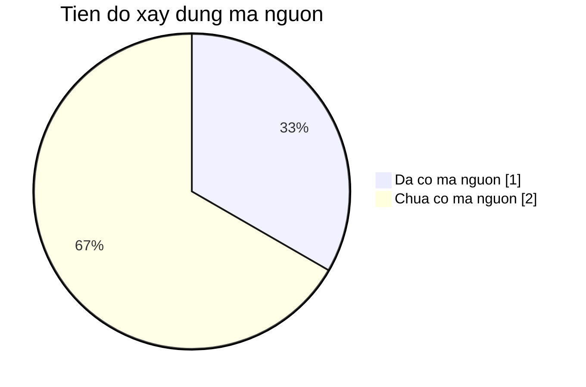

# Web Development · CSE122

**Phát triển ứng dụng Web cơ bản**  
Sinh viên: **Nguyễn Hòa Đông** · Mã sinh viên: **2551261003**

[Tong quan](#tong-quan) · [Tien do](#tien-do) · [Danh sach bai tap](#danh-sach-bai-tap) · [Cau truc](#cau-truc)

---

## Tong quan

Repository lưu bài thực hành của học phần Phát triển ứng dụng Web cơ bản. Mỗi bài gồm mã nguồn và tài liệu mô tả mục tiêu, cấu trúc, kiến thức sử dụng và cách kiểm tra kết quả.

| Nhóm kiến thức | Nội dung thực hành |
| :--- | :--- |
| **HTML** | Tổ chức nội dung, tiêu đề, đoạn văn, xuống dòng và liên kết. |
| **CSS** | Phông chữ, màu sắc, viền, khoảng cách và căn chỉnh bố cục. |
| **Kiểm tra bài làm** | Đối chiếu nội dung và thông số trình bày với đề bài. |
| **Tài liệu** | Giải thích vai trò của thẻ HTML và các quy tắc CSS. |

## Tien do

**Cập nhật ngày 14/11/2026 · 1/3 bài đang mở đã có mã nguồn.**



Biểu đồ thể hiện tình trạng mã nguồn, không thể hiện điểm số hoặc xác nhận nộp bài trên LMS.

| Bài | Tên bài | Tình trạng mã nguồn | Tài liệu |
| :---: | :--- | :--- | :--- |
| **01** | Trang thơ **Bốn mùa** | Đã có | [Mã nguồn](bai01/ex01/bai01.html) · [Thuyết minh](bai01/README.md) |
| **02** | Quảng cáo tour du lịch **Hành trình Trung Hoa** | Chưa có | Chưa cập nhật |
| **03** | Trang giới thiệu **Di sản Vịnh Hạ Long** | Chưa có | Chưa cập nhật |

## Danh sach bai tap

### Bai 01 · Bon mua

**Mục tiêu:** tạo trang trình bày bài thơ gồm ba khổ, với tiêu đề, màu sắc và đường phân cách theo đề.

**Nội dung thực hiện:**

- Khung thơ có nền vàng nhạt và viền xám.
- Tiêu đề màu đỏ trên nền hồng.
- Khổ đầu và cuối màu xanh; khổ giữa màu đỏ.
- Các câu thơ xuống dòng bằng `br`; hai đường `hr` phân cách ba khổ.
- Sử dụng HTML và CSS cơ bản, không cần JavaScript.

**Tệp chính:** [`bai01/ex01/bai01.html`](bai01/ex01/bai01.html).

### Bai 02 · Hanh trinh Trung Hoa

Chưa có mã nguồn được cập nhật trong repository.

### Bai 03 · Di san Vinh Ha Long

Chưa có mã nguồn được cập nhật trong repository.

## Cau truc

```text
cse122-2551261003/
├── README.md
└── bai01/
    ├── README.md
    └── ex01/
        └── bai01.html
```

Các bài tiếp theo được bổ sung vào thư mục riêng theo số bài. Tên tệp và cấu trúc bên trong từng bài được đối chiếu với yêu cầu của giảng viên.

## Xem ket qua

1. Mở tệp HTML của bài bằng trình duyệt hoặc bằng Live Server.
2. Đối chiếu giao diện với yêu cầu bài tập.
3. Đọc `README.md` trong thư mục bài để xem phần thuyết minh và các điểm kiểm tra.
